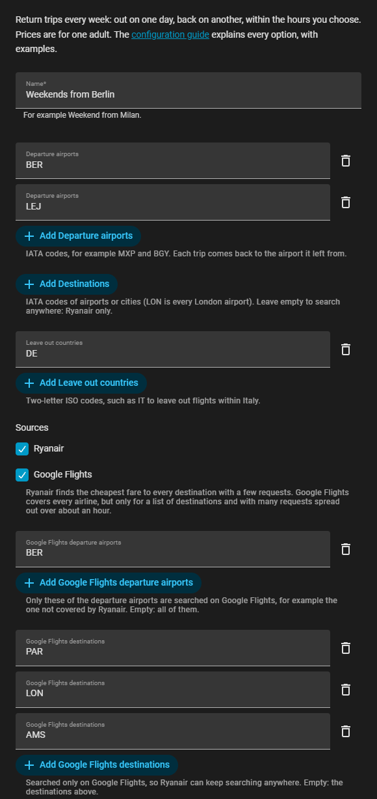
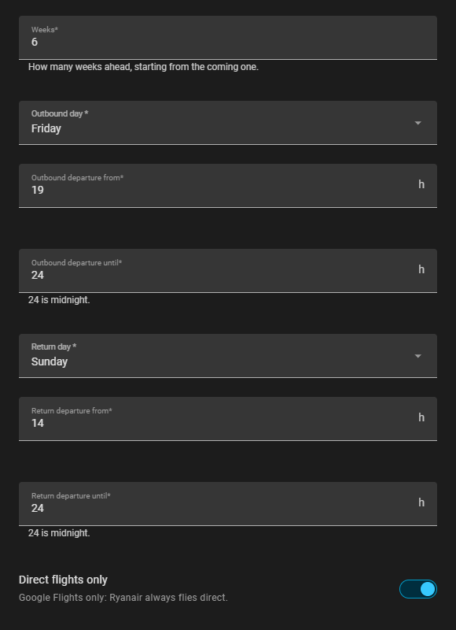
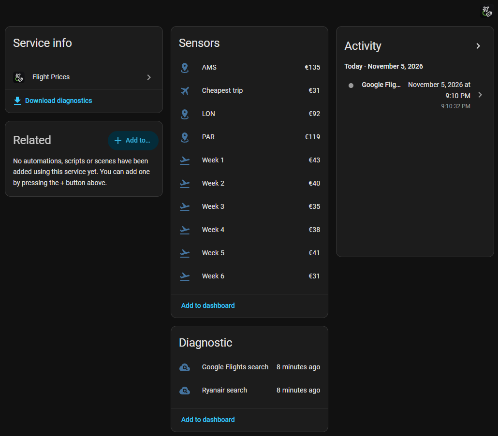
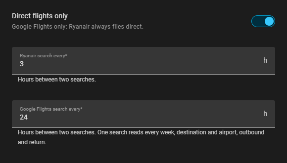
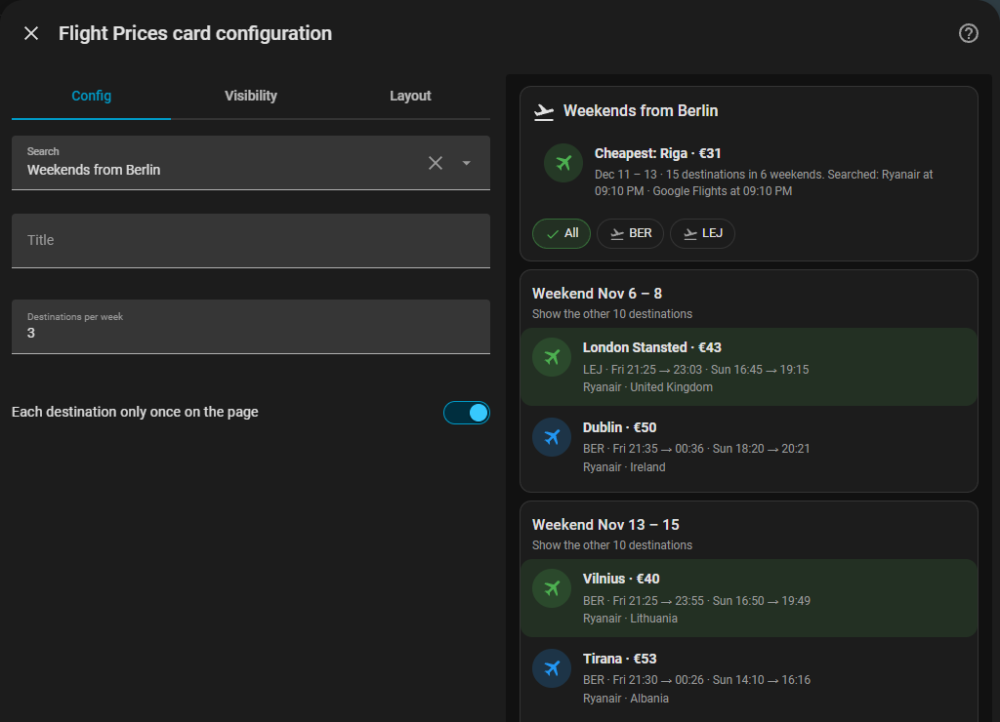

# Configuration guide

A search has many options, and most of them have a sensible default. This guide goes through them in the order of the form, says what each one changes, and ends with a few ready-made setups. The images come from a test instance with a made-up search, "Weekends from Berlin".

- [Before you start](#before-you-start)
- [Where from, where to](#where-from-where-to)
- [Sources](#sources)
- [When](#when)
- [After saving](#after-saving)
- [Changing a search](#changing-a-search)
- [How many requests](#how-many-requests)
- [Ready-made setups](#ready-made-setups)
- [The dashboard card](#the-dashboard-card)
- [When something looks wrong](#when-something-looks-wrong)

## Before you start

**One entry is one search**: the same departure airports, days and hours every week. Two different trips, such as weekends from home and a week by the sea in summer, are two entries: add the integration again. Two entries with the same airports, destinations and days are refused as duplicates.

**Codes, not names.** Airports, cities and countries are typed as codes, one per field: press **Add** for another. Lower case and spaces are fine, duplicates are dropped.

| What | Code | Examples |
|---|---|---|
| Airport | 3 letters, IATA | `BER` Berlin Brandenburg, `STN` London Stansted, `BGY` Milan Bergamo |
| City with several airports | 3 letters, IATA city code | `LON` every London airport, `PAR` Paris, `MIL` Milan, `ROM` Rome, `NYC` New York |
| Country | 2 letters, ISO | `DE` Germany, `IT` Italy, `GB` United Kingdom |

The airport code is on boarding passes and on the airport's page in any search engine. City codes work for destinations; for departure airports use the airports themselves, since each trip comes back to the airport it left from.

Prices are for **one adult**, return, in the currency of Home Assistant.

## Where from, where to

**Name** is the name of the device and the start of every sensor's name: "Weekends from Berlin" gives `sensor.weekends_from_berlin_week_1`. It is not in **Configure**: rename the entry or the device from their pages, as for any integration.

**Departure airports** (required): one or more airports. Ryanair is searched from each of them; every trip found comes back to the airport it left from, so with `BER` and `LEJ` a trip leaving from Leipzig returns to Leipzig. The card has a filter by departure airport.

**Destinations**: what to search for.

- **Empty** means **anywhere**: every destination Ryanair flies to from your airports, in the hours you choose. This is the most useful setting for "where can I go this weekend?". Only Ryanair can do it.
- **A list** limits the search to those airports or cities. Ryanair then searches only them too, and each one gets its own sensor with its lowest price over the weeks.

**Leave out countries**: countries you are not interested in, usually your own (`DE` from Berlin, so no Munich or Hamburg). They are taken out of what was found, not of the searches, so changing this list shows the new result at once without searching again.

## Sources

**Ryanair** reads the fare finder of ryanair.com: one request per departure airport and week returns the cheapest return fare to every destination. It is fast and light, and the only source that can search anywhere, but it covers Ryanair group flights only.

**Google Flights** covers every airline, but it has to be searched route by route, one way at a time, and the requests are spaced 20 to 30 seconds apart. So it needs a list of destinations, and a long list takes a long time (see [How many requests](#how-many-requests)).

The two lists for Google let you combine them well:

- **Google Flights destinations**: searched only on Google Flights. With destinations empty above, **Ryanair keeps searching anywhere** while Google checks a short list of places that Ryanair does not fly to, or flies to from another airport. Empty: Google uses the destinations above.
- **Google Flights departure airports**: the departure airports Google searches from, for example only the big airport when the small one is all Ryanair. Empty: all of them.

Google needs some destinations: in its own list or in the one above. With both sources, each week keeps the cheapest trip per destination and airport, whichever source found it.

## When

**Weeks**: how many weeks ahead, from 1 to 12. The first is the coming one: the week whose outbound day is today or later. Every week has its own sensor (`week_1`, `week_2`…), which moves on by a week as the days go by.

**Outbound day** and **Return day**: the weekdays of the trip.

- A return day **after** the outbound day is the same week: Friday to Sunday.
- A return day **before** it is the week after: Saturday to Monday, Sunday to Tuesday.
- The **same** day means a whole week: Saturday to Saturday.

**Departure from / until**: the window in which the flight **leaves**, in hours from 0 to 24, where 24 is midnight. "From 19 until 24" on Friday means take-off between 19:00 and 23:59; the landing can be after midnight. The end must come after the start. Narrow windows find fewer trips: if a week stays empty, widen them first.

**Direct flights only**: for Google Flights, which can also find flights with stops. Ryanair always flies direct.

## After saving

- **Ryanair** searches at once, in a few seconds: the week sensors have values right away.
- **Google Flights** searches in the background, one week after the other. Its trips appear week by week; the whole round takes some minutes per destination. The diagnostic sensor *Google Flights search* has `running: true` meanwhile.
- After that, Ryanair searches every 3 hours and Google every 24 hours. Results are saved: a restart of Home Assistant shows them at once and does not search again.

Each week sensor has the cheapest price as its state and up to 30 trips in its attributes (cheapest first, one per destination and departure airport), with times, flight numbers, airline, country and booking link. The diagnostic sensors show when each source last succeeded and the error of the last attempt.

## Changing a search

Everything but the name can be changed from **Settings → Devices & services → Flight Prices → Configure**. The form is the same, with two more options at the bottom:

- **Ryanair search every**: 1 to 24 hours, 3 by default.
- **Google Flights search every**: 6 to 168 hours, 24 by default. Going below a day is rarely worth it: prices of flights weeks ahead move slowly, and every round is many requests.

After saving, the search reloads. A source searches again **only if what it searches changed**: airports, destinations, days, hours, direct flights, or more weeks than its last search covered. Otherwise the saved trips stay: fewer weeks, other countries left out, other intervals and a change for Google only (Ryanair keeps its trips) need no new search.

## How many requests

| Source | Requests per round | Time |
|---|---|---|
| Ryanair | departure airports × weeks | about a second each |
| Google Flights | weeks × Google destinations × Google departure airports × 2 | 20 to 30 seconds each |

Google searches the return only when the outbound found something, so real rounds are often shorter. Some examples with 8 weeks:

| Google setup | Requests | Round |
|---|---|---|
| 3 destinations, 1 airport | up to 48 | about 20 minutes |
| 5 destinations, 1 airport | up to 80 | about 35 minutes |
| 14 destinations, 1 airport | up to 224 | about an hour and a half |
| 14 destinations, 2 airports | up to 448 | about three hours |

All the requests come from your home's internet connection. A Google round stops at the first sign of a block (cookie consent, captcha, too many requests) and is tried again at the next interval. **Keep the Google list short**, a handful of places that Ryanair does not cover, rather than every city you might like.

## Ready-made setups

**Weekend anywhere from home**, the defaults:
Departure airports your one or two nearest airports · Destinations empty · Leave out your country · Sources Ryanair · Weeks 8 · Friday from 19 until 24 · Sunday from 14 until 24.

**The same, plus a few cities on other airlines:**
as above, with Sources Ryanair and Google Flights · Google Flights destinations `PAR`, `AMS`, `LON` · Google Flights departure airports your main airport.

**Long weekend:**
Thursday from 17 until 24 · Monday from 15 until 24.

**A week away:**
Saturday from 6 until 14 · Saturday from 12 until 24 (same day: the week after) · Weeks 12 · Destinations a few beach places, or empty.

**Watching one trip:**
Destinations `LIS` · Sources both · Weeks 4: the sensor `sensor.<name>_lis` has the lowest price over the weeks, handy for an automation that tells you when it drops below a figure.

## The dashboard card

The integration comes with a card: edit a dashboard, **Add card**, search for **Flight Prices**. It works best in a section that takes the whole width.

- **Search**: which search to show. With only one, the card finds it by itself.
- **Title**: by default, the name of the search.
- **Destinations per week**: how many each week shows before "Show the other destinations". A tap on a week's title shows them all.
- **Each destination only once on the page**: on by default. Destinations are shared out in rounds from the cheapest, so each sits in its cheapest week when there is room and no week is left empty; a trip cheaper in another week says so. Turned off, every week shows its own cheapest destinations, and the same city can come back week after week.

The filter by departure airport at the top is remembered on each device. A tap on a trip opens the booking page; trips that pair two airlines on Google Flights are two tickets, with an **Outbound** and a **Return** button.

## When something looks wrong

**A week shows "No flights found".** Nothing leaves in the windows you chose, or nothing goes back in time: widen the hours, allow flights with stops for Google, or check the airports. Christmas and other holidays often have few flights.

**Google Flights trips do not appear.** Look at the *Google Flights search* sensor: `running: true` means a round is still going; an `error` says why the last one stopped. A block waits for the next interval; if it happens every day, make the Google list shorter.

**A destination appears in some weeks only.** With "Each destination only once on the page" the card shows it in one week; tap the week's title to see the whole list.

**The prices on the booking page are different.** Prices change all the time, and the integration's are as old as the last search (up to 3 hours for Ryanair, a day for Google). A Google trip with two airlines is two separate tickets: open both links. For a trip with one airline, Google may show a lower return fare than the two one-way prices added up.

**The card says "Configuration error".** Reload the page; if it stays, check that the integration is loaded in **Settings → Devices & services**.
